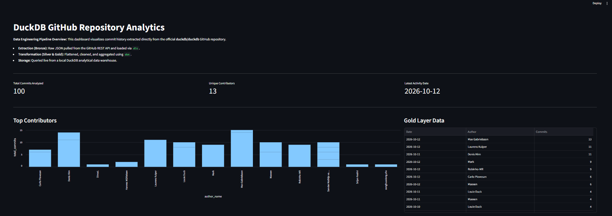

# 📊 GitHub Commit Velocity: End-to-End Local ELT Pipeline



An automated, local ELT (Extract, Load, Transform) pipeline built to analyze developer velocity and commit patterns from the official DuckDB GitHub repository. This project demonstrates a production-grade data engineering workflow utilizing a Medallion Architecture running entirely on a local machine.

## 🏗️ Architecture & Tech Stack

This pipeline extracts nested JSON data from a REST API, stores it in an in-process analytical database, cleans and models the data using industry-standard SQL transformations, and serves the final metrics through an interactive web dashboard.

* **Data Ingestion (dlt):** Python-based data load tool used to handle GitHub REST API pagination, automatic schema inference, and initial JSON flattening.
* **Data Warehouse (DuckDB):** High-performance, columnar OLAP database used as the local storage engine.
* **Data Transformation (dbt):** SQL-based modeling layer that handles data cleaning, type casting, and business logic aggregations.
* **Data Visualization (Streamlit):** Python framework used to build the final front-end dashboard for metric consumption.
* **Orchestration:** Scheduled via Windows Task Scheduler executing a local `.bat` script.

## 🥇 Data Modeling: Medallion Architecture

The pipeline processes data through three distinct layers to ensure data quality and separation of concerns:

1. **Bronze Layer (Raw):** 
   * Handled by `dlt`. The raw, heavily nested JSON response from the GitHub API is loaded directly into DuckDB without modification.
2. **Silver Layer (Cleansed):** 
   * Handled by `dbt`. Extracts specific values from the flattened JSON (e.g., `commit__author__name`), casts strings to proper `TIMESTAMP` data types, aliases column names for readability, and filters out incomplete or null records.
3. **Gold Layer (Aggregated):** 
   * Handled by `dbt`. Applies business logic to group the cleaned data by date and author, calculating the total daily commits per contributor to feed directly into the BI dashboard.

## 🧪 Data Quality & Testing

To ensure the integrity of the data pipeline, automated data quality tests are enforced in the Silver layer using dbt's native testing framework:
* **Unique Constraints:** Ensures no duplicate commit hashes enter the downstream tables.
* **Not Null Constraints:** Guarantees critical fields (like `commit_hash` and `author_name`) are never empty.

## 📂 Repository Structure

```text
├── transform_layer/          # dbt project directory
│   ├── models/
│   │   ├── silver/           # Silver layer SQL transformations
│   │   ├── gold/             # Gold layer SQL aggregations
│   │   └── schema.yml        # dbt data quality tests and schema definitions
│   └── dbt_project.yml       # dbt configuration file
├── extract_github.py         # dlt ingestion script (API to Bronze)
├── dashboard.py              # Streamlit dashboard application
├── run_pipeline.bat          # Automation batch script
├── .gitignore                # Untracked files (environments, databases)
└── README.md                 # Project documentation
🚀 How to Run Locally
To replicate this project on your local machine, follow these steps:

1. Clone the repository and set up the environment

Bash
git clone [https://github.com/ivanmanueladvincula-lab/Github-Commit-Pipeline.git](https://github.com/ivanmanueladvincula-lab/Github-Commit-Pipeline.git)
cd Github-Commit-Pipeline
python -m venv venv
venv\Scripts\activate
2. Install dependencies

Bash
pip install "dlt[duckdb]" dbt-duckdb requests streamlit pandas
3. Run the Extraction Phase
Pulls the latest commits from the GitHub API and creates the local github_pipeline.duckdb database.

Bash
python extract_github.py
4. Run the Transformation Phase
Executes the dbt models to build the Silver and Gold tables, and runs the data quality tests.

Bash
cd transform_layer
dbt run
dbt test
cd ..
5. Launch the Dashboard
Starts the local Streamlit server to visualize the Gold layer metrics.

Bash
streamlit run dashboard.py
Author: Ivan Manuel Advincula